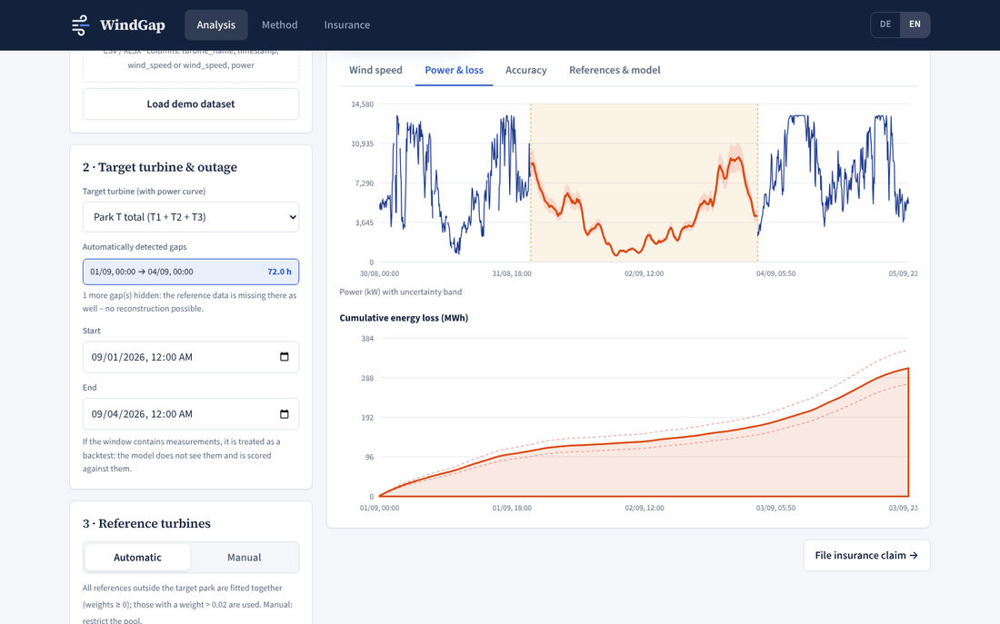
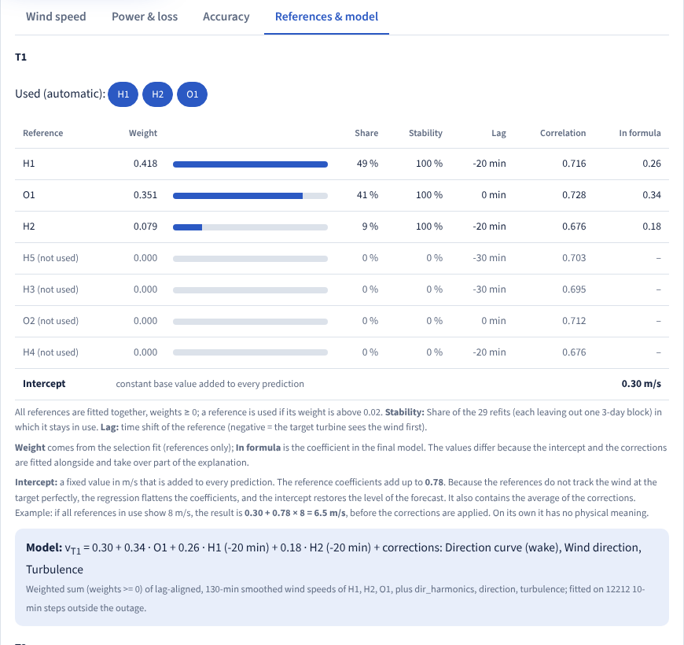
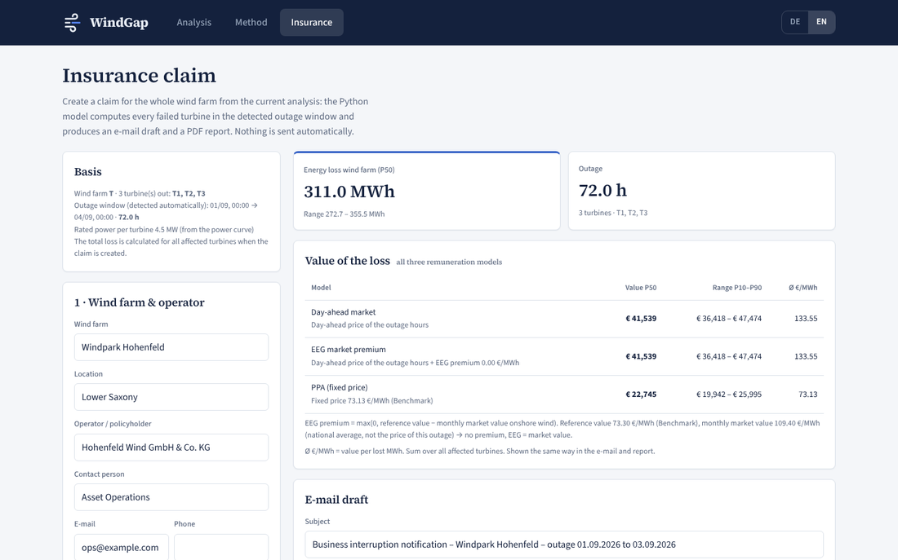

# WindGap

**How much energy did a wind farm lose while it was offline?**

🥈 **2nd place, BayWa r.e. challenge** · WATT THE HACK 2026, Munich

## Problem statement and WindGap Solution

When the communication link to a wind farm drops, the farm may stop feeding in, and its own wind measurements disappear with the link. To file a business-interruption insurance claim, the operator still has to say how much energy was lost. Today an analyst estimates it by hand from a neighbouring farm's wind data.

WindGap automates that estimate:

1. It finds the outage in the data.
2. It reconstructs the missing wind from reference wind farms that kept measuring.
3. It turns that wind into lost energy with the turbines' power curve.
4. It shows the fitted model so the results can be reproducible using the learnt linear equation for each wind turbine that faces power loss.
5. It drafts the insurance email and a detailed PDF report.

Everything runs locally in the browser.


---

## Result for the hidden test window (1–3 Sep 2026, 72 h)

| Turbine | Lost energy, P50 | Likely range (P10–P90) | Reference turbines the tool chose |
|---|---|---|---|
| T1 | 86.5 MWh | 70.6 – 102.2 MWh | H2, H1 |
| T2 | 124.1 MWh | 106.0 – 137.0 MWh | O2, H5, H2 |
| T3 | 101.4 MWh | 84.2 – 112.2 MWh | O2, H2 |
| **Park T** | **312.0 MWh** | **260.8 – 351.3 MWh** | |

At the day-ahead prices of those hours, the lost energy is worth about **€41,900**.

The 10-minute predictions are in [`CSV_output/`](CSV_output/): one file per turbine and one for the park total, with wind speed and power (P10/P50/P90) and the cumulative lost energy, plus a metrics summary. The app's **Export CSV** button and `python -m src.backtest` produce the same predictions for any dataset.

---

## Run it

Python 3.11 or newer (we use 3.13). No internet access is needed while the app runs.

```bash
git clone https://github.com/AdrianBodrug/Gone-with-the-wind-BayWe-Challenge.git
cd Gone-with-the-wind-BayWe-Challenge
python -m venv .venv && source .venv/bin/activate     # Windows: .venv\Scripts\activate
pip install -r requirements.txt
python server.py                                      # open http://localhost:8000
```

On the start page, choose **Load demo dataset** (the organisers' files in `data/`) or **Upload your own data**.

### Using a new dataset (e.g. the jury's test file)

The organisers' file format works as is: one `<turbine>_data.xlsx` (or `.csv`) per turbine and one `<turbine>_power_curve.xlsx` per target turbine. There are three ways to run on new files:

| Way | Command / action | What you get |
|---|---|---|
| In the app | Start page → **Upload your own data**, select all files | Outage detected automatically; full analysis, charts, claim |
| In the app, full model | `python server.py --data path/to/folder`, then upload the same files | As above, plus direction and turbulence corrections (see note) |
| Command line | `python -m src.backtest --data path/to/folder --out predictions.csv` | Held-out score on the shown week (4–9 Sep), loss per target turbine, 10-min predictions as CSV |

Note: the page sends only wind speeds to the model. For turbines that are also in the server's data folder, the server adds their direction, temperature and turbulence channels. Turbines it doesn't know are modelled from wind speeds alone, which is slightly less accurate. The command line always uses every channel.

Turbines whose name starts with the target park's letter (T) are targets, and every other park is a candidate reference. The outage is the longest run of missing target wind speeds in which the reference data is still available. You can adjust it in the app.

---

## How it works



One equation per target turbine:

```
v_target(t) = b0 + w1 · v_H1(t + lag1) + w2 · v_O1(t + lag2) + … + corrections
```

1. **Clean the data.** See [Missing data](#missing-data) below. Missing values are never read as zero, and the target series is never filled.
2. **Align the references.** Each reference turbine is shifted by the time lag at which it matches the target best: the highest correlation of the 10-min values, searched from −60 to +60 min, without the test week and the outage. The lag is the time of the reference reading relative to the target time. **+30 min** means the target at 12:00 is matched with the reference reading from 12:30: the wind reaches the target first and the reference 30 min later. **−30 min** means the reading from 11:30. The references are then smoothed with a centred moving average over 30, 70 or 130 min, whichever fits the test week best for that turbine. A reference far away cannot see the target's local gusts, and its own gusts are noise for the target. Smoothing removes them, and it keeps the model robust to a lag that is off by 10–20 min.
3. **Pick the references automatically.** Forward selection on the shown test week (4–9 Sep), with the model fitted without that week. The model starts with the single reference that predicts the week best, then keeps adding the reference that lowers the error most. It stops when the next one gains less than 0.5 %. The score is the mean of wind RMSE, wind MAE, power RMSE and power MAE relative to a model with all references. Weights are ≥ 0. Only references measured during the outage (≥ 90 % of its steps) are candidates. This covers the "automatic turbine selection" bonus.
4. **Add corrections only if they help.** Direction curve (wake), wind direction, turbulence, time of day, temperature change and weather terms (temperature, air pressure, air density, turbulence intensity) are tried the same way. Each is kept only if it lowers the test-week score by at least 0.5 %. The final model is then refitted on all data outside the outage.
5. **Convert wind into energy.** The predicted wind goes through the power curve, averaged over the model's own error distribution ("expected power"). The power curve is non-linear (flat below cut-in and at rated power), so pushing only the single most likely wind speed through it would bias the energy total.
6. **Attach an honest range.** P10/P90 come from how far the model's energy estimate was off on past 3-day blocks it had not been fitted on.

### Missing data

- **One 10-min grid** for all files: absent rows become gaps, never 0.
- **Cleaning** sets these to missing:
  - rows with 0.0 m/s in every channel (logger fault);
  - impossible values (wind < 0 or > 40 m/s, direction outside 0–360°);
  - a stuck wind sensor (the same value for ≥ 1 h);
  - a constant air pressure (O park placeholder).
- **Short reference gaps (≤ 30 min)** are interpolated linearly: wind speed, temperature, air pressure and turbulence. Wind direction is filled via its sin/cos, so 350° → 10° passes through 0°. The target turbine is never filled.
- **Smoothing** also bridges single missing values: the moving average needs only just over half of its window.
- **Training** leaves out steps without a target measurement. With 30 % of T1's rows removed at random, the test-week wind RMSE moves from 1.381 to 1.386 m/s.
- **References during the outage:** only references measured in ≥ 90 % of the outage steps are candidates. Steps where a selected one is still missing use a model with the references available then (`model_used` in the CSV).
- **Corrections** are only offered if more than 50 % of their data is present. Turbulence and weather are averages over the references that have them. Without these channels the model runs on wind speed alone (T1 test-week RMSE 1.38 → 1.53 m/s).
- **No reference data at all:** nothing is estimated. Such gaps are not offered as outages, and the analysis stops if more than half of the window cannot be reconstructed.

Why a linear model: in our early experiments a gradient-boosting model was not more accurate in cross-validation (wind RMSE 1.16 vs 1.15 m/s). Wind at the target correlates with the reference parks at only about 0.7. That limit holds for any model. The brief also asks for explainability over accuracy when the two conflict. Here there was no conflict, so we kept the version that anyone can recompute.

---

## How accurate is it

We measure accuracy in two ways, because they answer different questions.

**1. Fully held-out test: the shown test week (4–9 Sep).** We blank the target turbines' wind for that week, as if it were an outage, and run the complete tool on it. The settings are chosen on the 6 days after it (10–15 Sep), the model is fitted without the week, and its estimate is compared with the real measurements. The model sees nothing of this week, so this is the closest to how it will do on new data. Reproduce it with `python -m src.backtest`.

| | T1 | T2 | T3 | Park |
|---|---|---|---|---|
| Measured energy | 213.2 MWh | 312.2 MWh | 271.7 MWh | 797.1 MWh |
| Estimated energy | 260.6 MWh | 309.0 MWh | 266.1 MWh | 835.7 MWh |
| Deviation | +22.3 % | −1.0 % | −2.1 % | **+4.8 %** |
| Wind speed RMSE | 1.55 m/s | 1.20 m/s | 1.29 m/s | |
| Wind speed MAE | 1.19 m/s | 0.90 m/s | 0.98 m/s | |
| Power RMSE | 940 kW | 744 kW | 810 kW | |
| Measured value inside P10–P90? | no | yes | yes | |

T1 is the hardest turbine to reconstruct: for this week its estimate was 22 % too high and outside its range. T2 and T3 are within ±2 %.

**2. Selection week, as shown in the app.** For the hidden outage, the settings are chosen on the shown test week itself, with the model fitted without that week. The Accuracy tab, the PDF report and `CSV_output/metrics_summary_shown_test_week.csv` show the scores on that week:

| | T1 | T2 | T3 | Park |
|---|---|---|---|---|
| Wind speed RMSE | 1.38 m/s | 1.15 m/s | 1.29 m/s | 1.28 m/s |
| Energy deviation | +4.6 % | +0.7 % | −2.3 % | +0.7 % |

Because the settings were picked to do well on this week, these scores are somewhat better than what to expect on unseen data. Table 1 is the stricter test.

**3. Range.** Over 29 past 3-day blocks the model had not been fitted on, its energy estimate was off by ±11 % on average. The P10–P90 range comes from the spread of these errors.

The app shows the same metrics for any window you choose. If the window contains real measurements, it is treated as a backtest and scored against them.

---

## The app

| Page | What it shows |
|---|---|
| **Start** | Load the demo dataset or upload your own files |
| **Analysis** | Detected outage (adjustable); target turbine or the whole park; reference pool (automatic or manual). Tabs: **Wind speed** (forecast vs. reference and measurements), **Power & loss** (power with P10–P90 band, cumulative lost MWh), **Accuracy** (metrics per turbine), **References & model** (the selection path step by step, weights, lags, intercept and the fitted equation). **Export CSV** downloads the 10-min predictions and metrics |
| **Method** | The method on one page, with the live equation of the current analysis |
| **Insurance** | Claim form, email draft, PDF report preview (see below) |

German and English, switchable in the header.



### Where each requirement is covered

| From the brief | Where |
|---|---|
| Accuracy metrics | Analysis → Accuracy; Method page; PDF report (method and accuracy) |
| Predicted wind speed time series | Analysis → Wind speed |
| Explanation of the method and its uncertainty | Method page; Analysis → References & model; PDF report |
| Energy loss in kWh and its visualisation | Analysis KPI and Power & loss tab (MWh, with P10–P90) |
| Inputs: time series, power curves, outage period | Upload on the start page; outage detected automatically and adjustable |
| Bonus: insurance report | Insurance tab: email draft + PDF |
| Predictions for the hidden test period | `CSV_output/`; Export CSV button; `python -m src.backtest` |
| Bonus: additional parameters | Wind direction (wake), turbulence, time of day, temperature, air pressure and air density, each kept only when it lowers the error |
| Bonus: automatic turbine selection | Forward selection of the references, shown step by step in the app; manual pool optional |

---

## Insurance claim



The Insurance tab turns the analysis into a draft notification for the insurer. These values come from the data, so nobody types them in:

- the outage window and its duration
- the affected turbines (every turbine of the park that is offline in that window)
- their rated power
- the lost energy

The form asks only for what no data file contains: the wind-farm, operator and insurer details, and optionally the operator's own contract prices. **Create claim** returns:

- **Email draft**: what happened, lost energy for the wind farm (P50 and range), its value under all three remuneration models, the method and its accuracy in two sentences, and a note that grid-operator metering data will follow. You can copy it or open it in your mail app. Nothing is sent automatically.
- **PDF report**, previewed in the page before download:
  - summary;
  - reconstructed wind and energy charts;
  - valuation;
  - method and accuracy, with a validation chart;
  - an appendix with the regression weights, a per-turbine breakdown and SHA-256 fingerprints of every input file, so the numbers can be audited.

Missing facts appear as visible `[placeholders]`. The tool never invents a policy number or a price. A sample is in [`docs/sample_claim/`](docs/sample_claim/).

### What the lost energy is worth

Each 10- or 15-minute interval is valued at its own price. Prices come from one file in the repo, `data/prices/day_ahead_DE-LU.csv` (German day-ahead market, Jan 2024 – Oct 2026; source: Energy-Charts / SMARD, CC BY 4.0). The app never goes online for prices.

| Model | Value per lost MWh | Default if the operator gives no price |
|---|---|---|
| Day-ahead market | Day-ahead price of that interval (negative prices count as 0: the plant would have curtailed) | – |
| EEG market premium | Day-ahead price + max(0, EEG reference value − monthly market value of onshore wind); nothing in negative-price hours (§51 EEG) | Reference value 73.30 €/MWh (average award, 2024 onshore tenders) |
| PPA | Fixed price | 73.13 €/MWh (German onshore wind PPA benchmark, Veyt) |

For the hidden window, the September 2026 market value of onshore wind (109.40 €/MWh) is above the reference value. The EEG premium is therefore 0 and the EEG value equals the market value (€41,938). The PPA value is €22,814.

---

## Repository map

```
server.py                 local web server: serves the app, /api/analyze, /api/export, /api/claim
templates/
  windgap.html            the app (single self-contained page, fonts embedded)
  claim_email.txt.j2      email template
src/
  data_io.py              load xlsx/csv, align to 10 min, clean sensor faults
  outage.py               detect outages from missing target data
  model.py                estimate_loss(): lags, smoothing, forward selection, fallback, P10/P90
  energy.py               power curve, expected power, kWh
  backtest.py             CLI: held-out shown-week score + hidden-window predictions
  export.py               CSV export (per turbine, park total, metrics summary)
  webapi.py               /api/analyze: page request -> estimate_loss()
  assessment.py           runs the model for every affected turbine -> AssessmentResult
  claimapi.py             /api/claim: model run + email + PDF, kept in memory only
  report.py               email draft and PDF report
  pricing.py              day-ahead / EEG / PPA valuation
  schema.py               data contracts between model, report and app
scripts/
  make_claim_package.py   email + PDF from the command line
  update_prices.py        refresh the price CSV (needs internet)
Dockerfile                container for the app (docker build / docker run, see below)
requirements.txt          packages the app and model need (requirements-dev.txt: + notebook, Streamlit example)
vercel.json               Vercel deployment (entry point server:app)
data/                     organiser files (+ prices/)
CSV_output/               predictions for the hidden test period
docs/                     sample claim, screenshots
notebooks/                data exploration
examples/                 minimal Streamlit example of the estimate_loss() interface
```

Other commands:

```bash
python server.py --reload                         # re-imports src/ on every request (development)
python -m scripts.make_claim_package              # email + PDF for the demo data -> outputs/
python -m src.backtest --no-extras                # references-only model, for comparison
docker build -t windgap . && docker run -p 7860:7860 windgap   # same app in a container -> http://localhost:7860
```

**Vercel.** The repo deploys to Vercel as is (Python preset): `server.py` exposes a WSGI `app` that runs the same request handler, and the PDF report travels inside the claim response, so it works when requests land on different server instances. The first request after a pause takes a few seconds while the data loads.

---

## Data notes

The organisers' data covers 10 turbines in 3 parks: T1–T3 are the targets, H1–H5 and O1–O2 are the references. It spans 1 Jul – 30 Sep 2026 in 10-minute steps, with Berlin time stamps.

- In the hidden window, all three T turbines are blank at the same time. A T turbine therefore can never serve as a reference for another T turbine; only the H and O parks are used.
- The outage lies in the middle of the data, so the model learns from both sides of it.
- The O park has no turbulence channel, and its air pressure is a constant (990.27). Features that need these are tested only where the data exists.
- On 3–4 Aug, rows are missing from every file, references included. The app hides gaps like this, because there is nothing to reconstruct them from.
- Prices are matched in UTC, so the extra hour when summer time ends is counted correctly.

## Limitations

- The method assumes that the relationship between the parks during the outage is the same as in the rest of the data. Unusual weather (e.g. a storm front with an unusual track) can break that, and the P10–P90 range only reflects errors seen in the past. In addition, the project mainly aims to produce models that are **explainable** while **accurate**, and only linear regression and boosting methods are experimented, additional ML models could be incorporate to see if accuracy can be improved even further. 
- The estimate is the energy the turbines *could* have produced. Whether they actually stopped has to be confirmed with the grid operator's metering data, and the email says so.
- The power curve is the manufacturer curve. Availability, curtailment and icing are not modelled.

## Team

- **Adrian Bodrug** ([AdrianBodrug](https://github.com/AdrianBodrug)): app design, insurance claim (email, PDF, valuation)
- **Pengxuan (Peter) Huang** ([pengxuanHuang](https://github.com/PeterrHH)): model and backend
- [weinbrennerm1-code](https://github.com/weinbrennerm1-code): WindGap frontend
